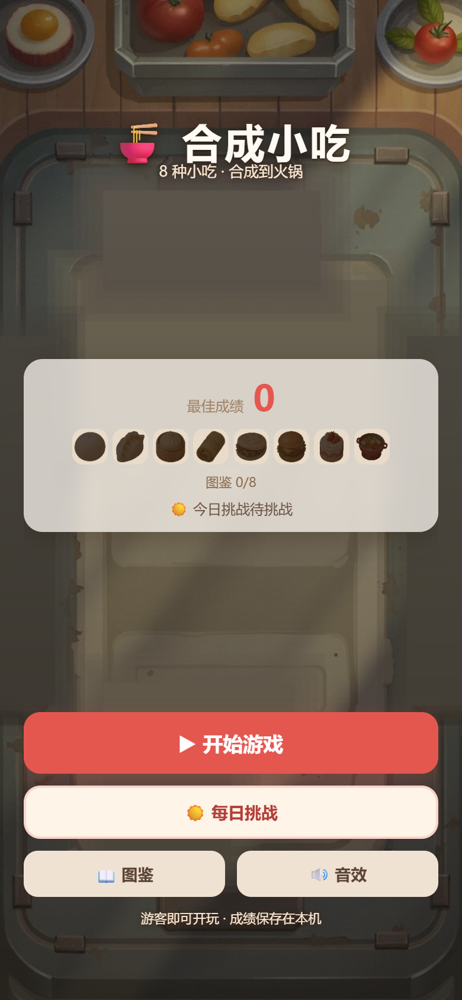
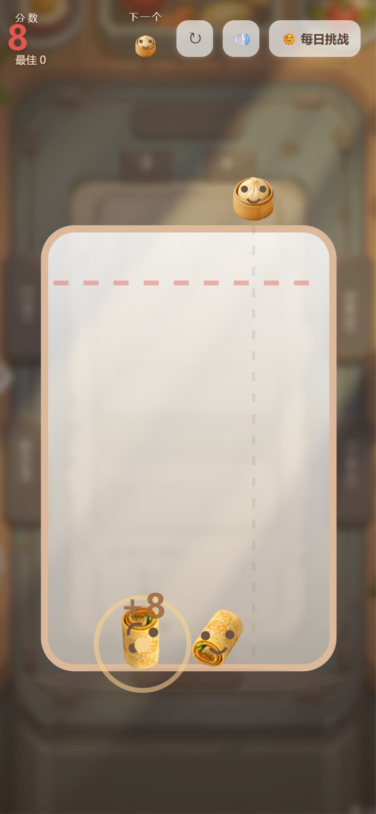

# 合成小吃 · Snack Merge

一款零依赖的 H5 物理合成小游戏：拖动投放小吃，两个相同的合体升级，从汤圆一路合到火锅。
*A zero-dependency casual merge game built with HTML5 Canvas & Matter.js.*

**在线试玩**：https://xin6014.github.io/snack-merge/




## 亮点

- 物理堆叠合成：8 级小吃段位（汤圆 → 火锅），越线判负、连锁合成；
- 手感工程：针对圆形刚体堆叠的"自漂移"问题，通过摩擦/阻尼与终端速度调参，把落地偏移压到 0.2 格以内；
- 每日挑战：以日期为随机种子，全玩家同日同序列、成绩可比——纯前端实现，无需服务器；
- 图鉴收集：跨局永久记录、全收集庆祝（"满汉全席"）；
- 战绩分享卡：一键生成竖版战报（罐子快照 + 分数 + 图鉴进度）；
- 全合成音频：Web Audio API 程序化生成全部音效与背景音乐（含动态律动循环），零音频素材；
- 移动端优先：竖屏布局、DPR 缩放、物理休眠优化，稳定 60fps；
- 体积控制：WebP/JPEG 素材管线将首包从 5.4MB 压缩到 0.5MB，扫码秒开。

## 技术栈

HTML5 Canvas · Matter.js · Web Audio API · 原生 JavaScript
—— 零框架、零构建工具、纯静态部署（任何静态托管均可直接运行）

## 质量保障

- Playwright 自动化冒烟测试，覆盖投放/合成/判负/重开/分享卡/每日挑战全链路回归；
- 素材管线：AI 生成资产 → 自动抠图与居中 → WebP/JPEG 压缩 → 一键发布包构建。

## 本地运行

直接双击打开 `docs/index.html` 即可游玩（完全离线、无需安装）；或：

```
python -m http.server 8000
```

## 目录

- `docs/` —— 游戏本体（GitHub Pages 部署目录，推送到仓库后即可在线玩）
- `screenshots/` —— 界面截图
